[简体中文](README.zh-CN.md)

# Flux Studio

Parametric RF inductor and transformer layouts, EMX campaigns, and equivalent-circuit fitting in one desktop workspace. Structures are pluggable: the differential inductor is built in, and any other structure loads as a **structure pack**.

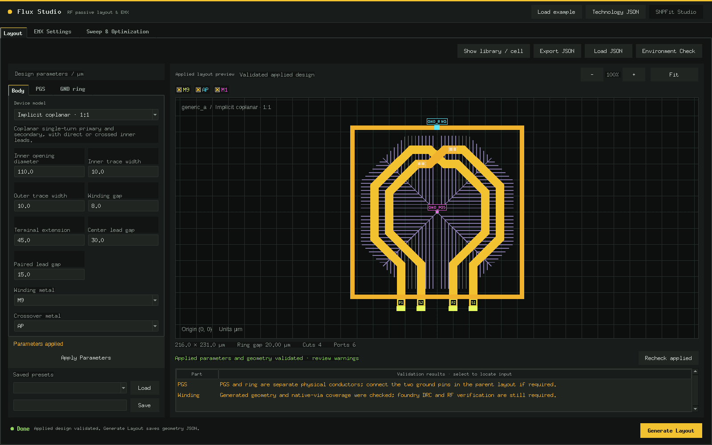

*The built-in differential inductor with centre TAP, patterned ground shield and ground ring, on the fictional example technology.*

## What it does

- Preview and generate a symmetric differential inductor (optional centre TAP) out of the box, with optional patterned ground shield and ground ring.
- Load further structures — transformers, single-ended or tapped inductors, baluns, your own variants — as [structure packs](docs/STRUCTURE_PACKS.md). Pack models get the same parameter panel, rule checks, native generation, EMX, optimization and SNPFit hand-off as the built-in inductor.
- Place your own pins along the terminal leads with the **Leg Pin manager**, and point every EMX objective or constraint at the pins it should be measured between.
- Look at the applied layout in **3D** next to the 2D editor (optional, through [Layout 3D Viewer](https://github.com/chloeyntu-byte/layout-3d-viewer)).
- Read user technology JSON for offline geometry, or discover the technology attached to a user-owned OA design library for native layout generation.
- Configure EMX, sweep typed parameters, optimize multiple objectives, inspect candidate tables, heatmaps, surfaces and retained SNP results.
- Open selected results in the bundled **SNPFit Studio**, or launch it independently to fit explicit RLC(K) circuits to Touchstone data; export numerical results and SPICE models.

## Built-in structure and structure packs

The open-source edition contains **one** built-in structure: the symmetric **differential inductor** with optional centre TAP. Each of the other inductor and transformer structures Flux has been used with — the implicit coplanar transformer (direct and crossed leads), the single-ended octagonal inductor, the coplanar transformer and the stacked transformer — is a **separate structure pack**. These packs are not shipped with this repository. If you need one, please contact the maintainers through [GitHub Issues](https://github.com/chloeyntu-byte/flux-studio/issues). You can also write your own pack; see [Structure packs](#structure-packs) below.

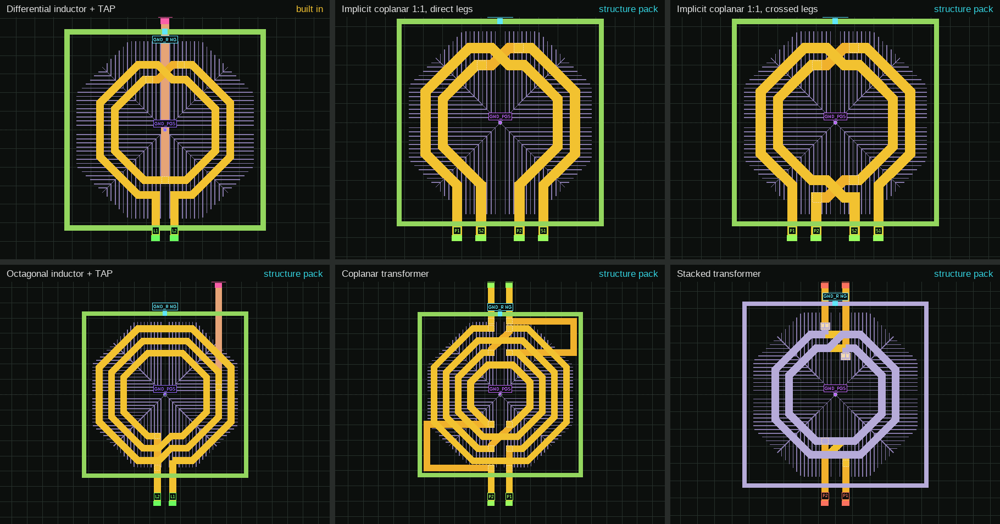

*Top left: built-in differential inductor. All other tiles are **structure packs** (not included): implicit coplanar 1:1 with direct and crossed leads, octagonal inductor with TAP, coplanar transformer, stacked transformer.*

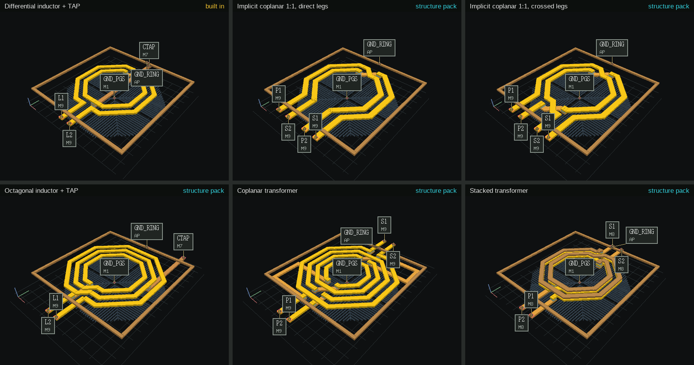

*The same six layouts in 3D Studio. Everything except the top-left tile is a **structure pack** (not included).*

## Feature tour

### Layout preview and shielding

Every parameter edit is validated by the same geometry core that writes the final layout. **Apply Parameters** redraws the preview, lists rule warnings and keeps the view in sync with the stored design.

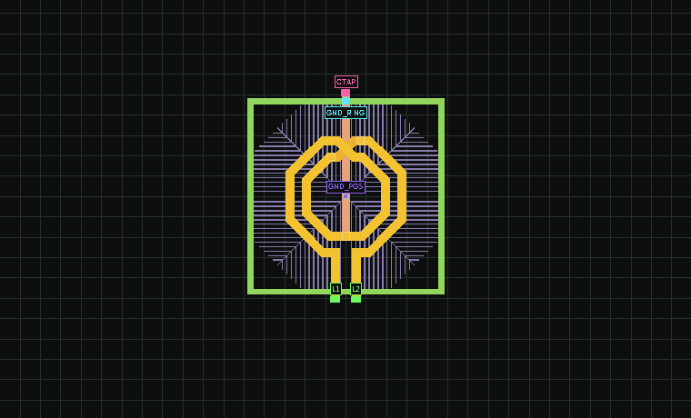

*Inner diameter, turns and width change; the winding, crossovers, centre TAP, PGS and ground ring are regenerated each time (built-in differential inductor).*

The patterned ground shield (PGS) and the ground ring are independent, optional parts with their own metal, size and connection settings:

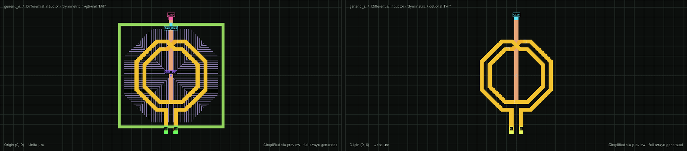

### Optional 3D preview

The 2D/3D selector on the preview toolbar switches between the 2D editor, **3D Studio** (solid metals) and **3D Metal** (metal-coloured layers with the PGS fingers visible). Every applied preview, including leg-pin edits, is pushed to the 3D view.

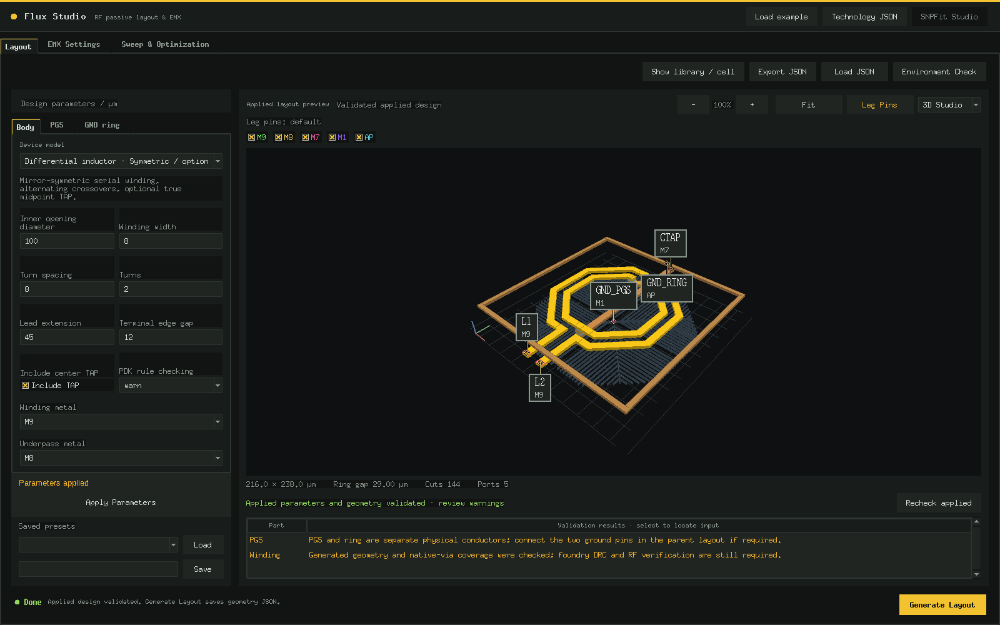

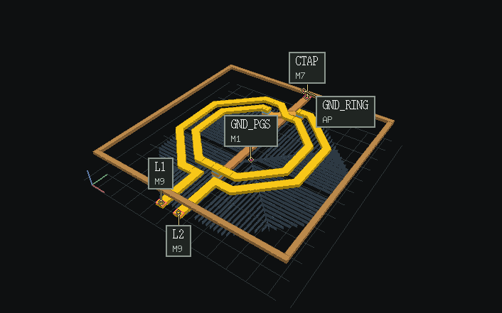

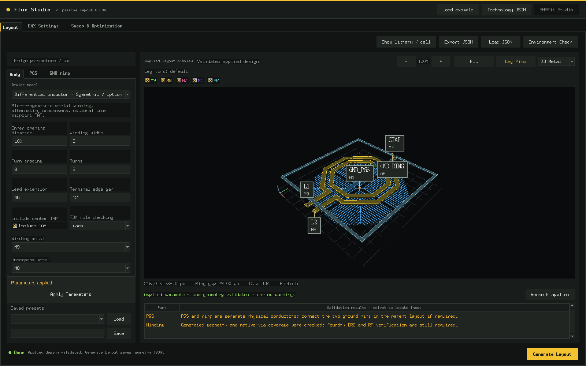


*Stacked transformer in 3D Metal. This structure is a **structure pack** and is not part of the repository.*

**3D needs Layout 3D Viewer.** The preview uses the embedding interface of [Layout 3D Viewer](https://github.com/chloeyntu-byte/layout-3d-viewer): Flux imports its `native/embed.py` module, whose contract is described in that repository's [docs/EMBEDDING.md](https://github.com/chloeyntu-byte/layout-3d-viewer/blob/main/docs/EMBEDDING.md). Use the latest version of Layout 3D Viewer.

```sh
git clone https://github.com/chloeyntu-byte/layout-3d-viewer.git /path/to/layout-3d-viewer
# the Python that runs Flux needs PyOpenGL 3.1.7 and pyopengltk 0.0.4;
# installing them into a separate folder keeps that interpreter unchanged
python3 -m pip install --target /path/to/flux-gl PyOpenGL==3.1.7 pyopengltk==0.0.4

export FLUX_VL3D_ROOT=/path/to/layout-3d-viewer     # the Layout 3D Viewer checkout
export FLUX_VL3D_PYTHONPATH=/path/to/flux-gl        # optional: the folder above
python3 -B app.py --example
```

- Without `FLUX_VL3D_ROOT` Flux has the 2D preview only and behaves exactly as before; no 3D selector is shown.
- With a conda or miniforge Python, use the latest Layout 3D Viewer: its `prepare_runtime()`, which Flux calls before Tk starts, loads the system GL libraries so Tk and OpenGL share one X11 stack.
- `./launch.sh` passes both variables through, and they can also be set in `flux_config.sh` (see `examples/flux_config.sh`).
- If the 3D engine cannot be loaded or OpenGL fails when the view first opens, Flux reports the reason in the status line and stays in 2D.

### Leg Pin manager

**Leg Pins** on the preview toolbar turns the Layout page into a pin editor for the terminal leads ("legs"). Everything except the legs is dimmed and pins are drawn in one bright colour; the left panel lists every leg with its pins, their distance from the free end and their length.

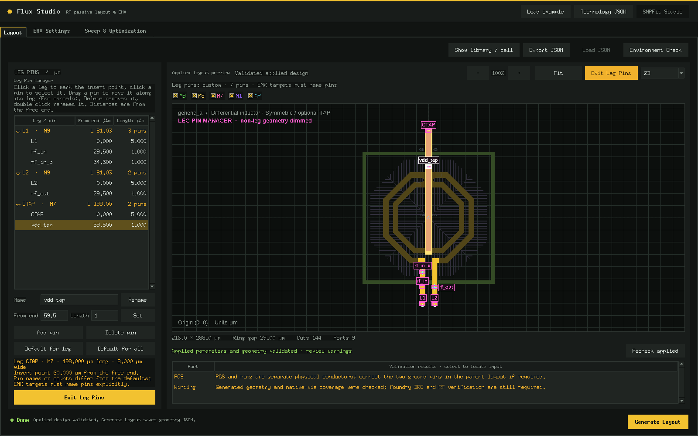

- Click a leg to mark an insert point, then **Add pin** (1 µm long, as wide as the leg). Several pins per leg are allowed; a leg can also be left without a pin.
- Drag a pin to move it along its own leg (Esc cancels the drag); double-click or **Rename** to rename it; **Delete** removes it; **Default for leg / Default for all** restore the generated pins.
- Positions are stored as a fraction of the leg length, so when a sweep changes the lead extension every pin keeps its relative position.
- Pins with the same name form one shorted EMX terminal (Flux asks first). Names that would join two windings, mix signal and TAP pins, or reuse the ground pin names are refused.
- The pin layout is saved with design JSON, presets and EMX campaigns. A layout identical to the defaults is not stored.

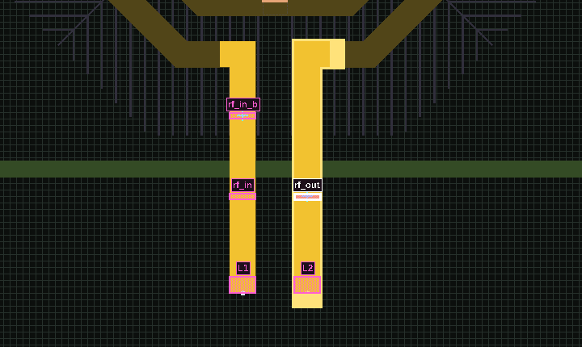

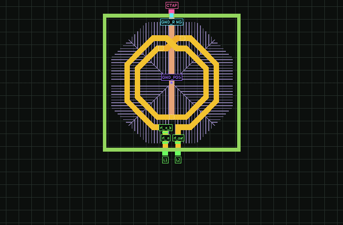

*Left: a pin dragged along its leg. Right: as the lead extension grows and shrinks, every pin keeps its fraction of the leg length.*

With the 3D preview enabled, Leg Pins puts the 2D editor and the 3D view side by side; the selected pin is marked in 3D, and clicking a pin in 3D selects it in the editor (repeated clicks step through pins that share a name).

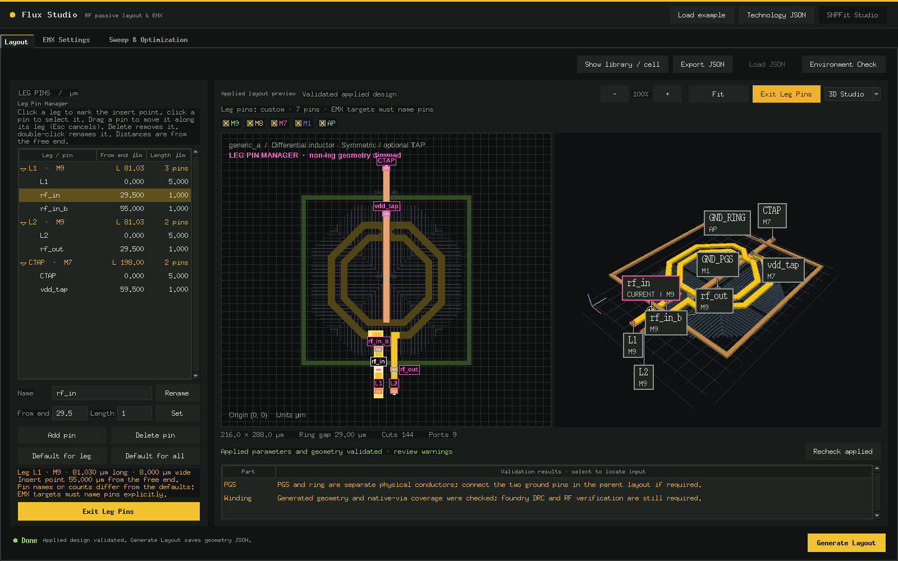

### EMX metrics on chosen pins

Objectives and constraints can name the pins a metric is measured between. In the goal editor, L, Q, Lp, Ls, Qp and Qs take a differential pair (+, −; all other signal pins are left open) and k takes two pairs. The goal is written as `L[rf_in,rf_out]`, also in the advanced text form (`L[rf_in,rf_out], 2e9, maximize`).

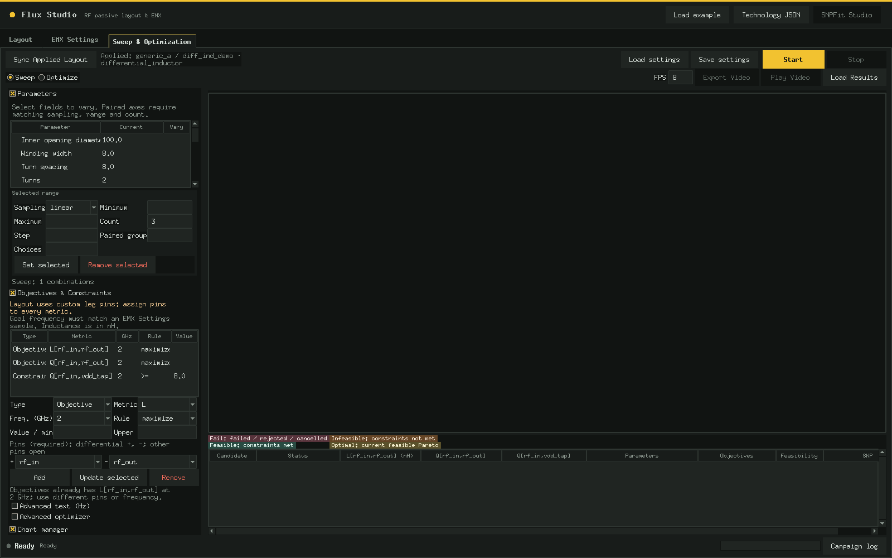

- The same metric on different pins is a different goal, and the results table, charts and optimization video get one column per pin-assigned metric.
- Without custom pins, leaving the pins blank keeps the built-in winding pair. Once a layout uses custom leg pins, every metric must name its pins; goals whose pins no longer exist in the synced layout are shown in red.

### Sweeps and heatmaps

A sweep solves every combination of the chosen parameter values with EMX. The heatmap puts two swept parameters on the axes and colours each cell by one metric at one frequency (here Qp at 1 GHz), so trends and the useful region are visible at a glance. Clicking a cell selects that candidate in the result table.

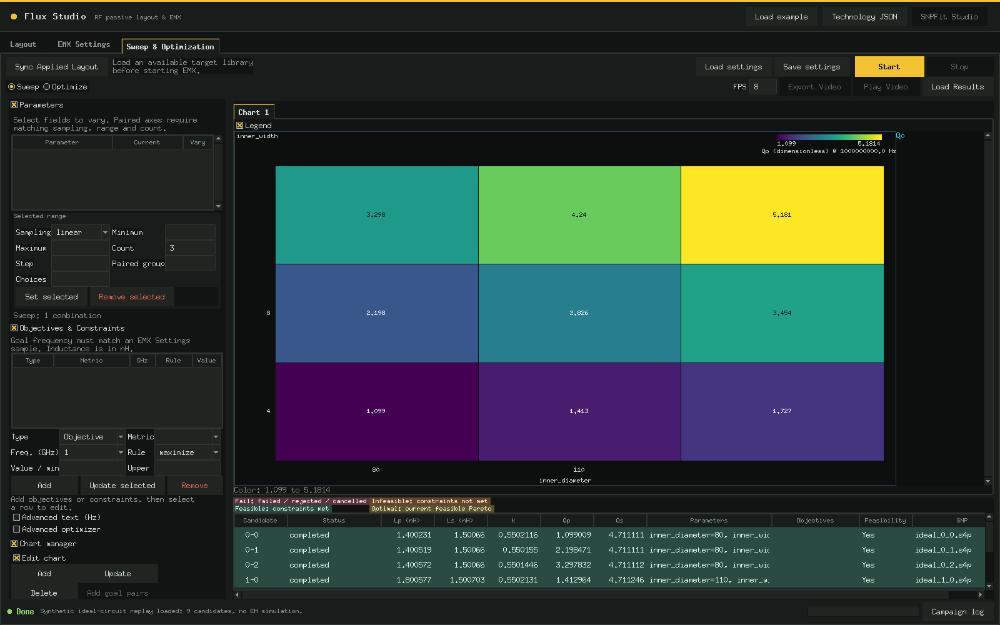

*Synthetic replay of nine ideal coupled-inductor SNPs (see Quick start); not an EM prediction.*

### Multi-objective optimization and the Pareto front

Optimize mode runs NSGA-II over the same parameters with several objectives and constraints at once, for example maximize Qp, keep Lp close to a target and push coupling k. There is rarely a single winner. A design is on the **Pareto front** when no other feasible design is at least as good on every objective and better on one; everything off the front loses on at least one objective without gaining elsewhere. With two objectives the front is a curve, with three it is a surface that you can rotate, and moving along it shows what one objective costs in another.

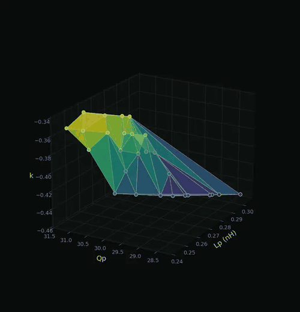

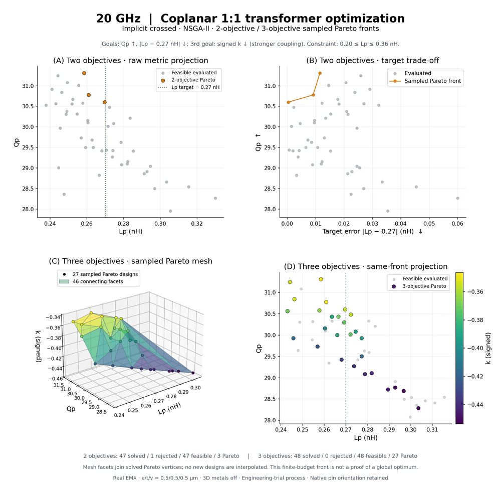

*A real EMX optimization of a 20 GHz coplanar 1:1 transformer (implicit coplanar, crossed leads — a **structure pack**, not included). Every point is one solved candidate; facets only join solved Pareto designs, nothing is interpolated, and a finite-budget front is not a proof of a global optimum.*

### SNPFit: from S-parameters to an equivalent circuit

Select a result and hand it to the bundled **SNPFit Studio**. It fits an explicit RLC(K) circuit to the Touchstone data, compares the fitted model with the EMX samples point by point (L, Q and k for each winding), and can write a native schematic, symbol and layout illustration for the circuit. SNPFit also runs on its own for any Touchstone file (see Quick start).

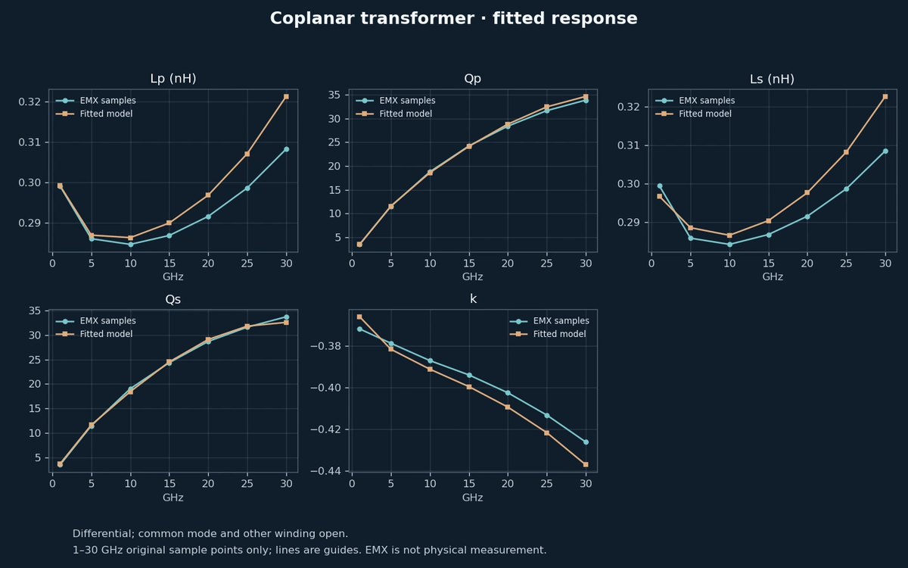

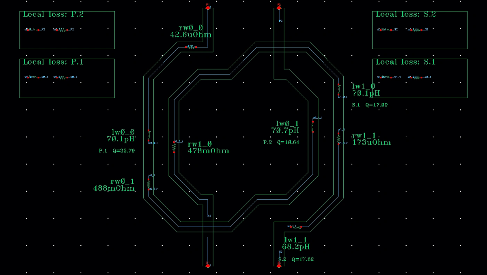

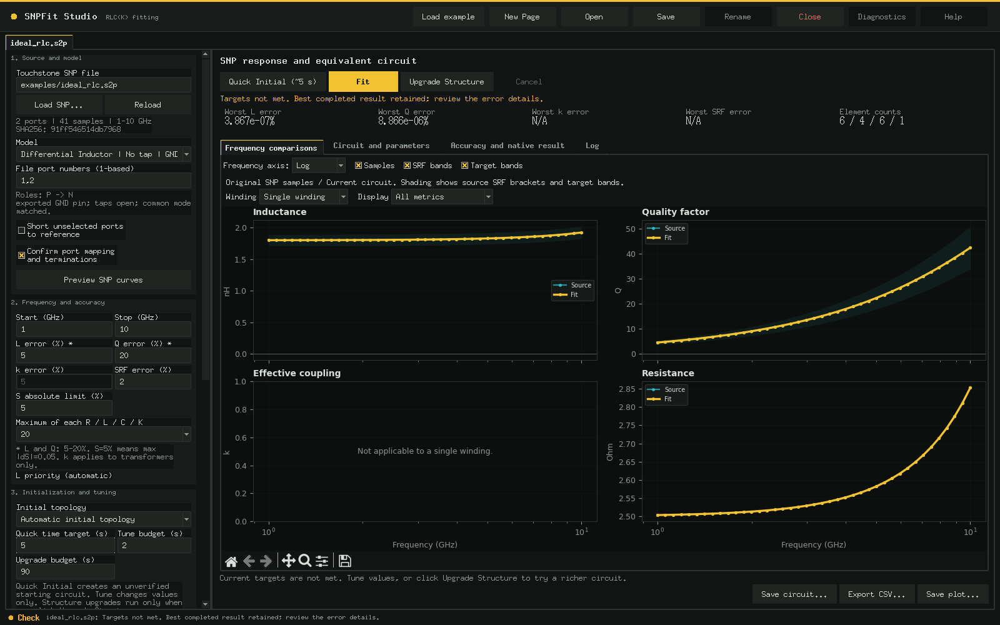

*The first two images come from an independently generated, extracted and fitted coplanar transformer (a **structure pack**, not included); EMX is a simulation, not a measurement. The last image uses the bundled synthetic RLC example.*

## Requirements

Use an existing **Python 3.11+** with Tk, NumPy and Matplotlib. The shared theme itself supports Python 3.6+ and Tk 8.5/8.6. This release was checked on Linux with Python 3.11, NumPy 2.4 and Matplotlib 3.10; no environment or system component is installed by the launchers. Flux's geometry CLI uses only the standard library.

Cadence Virtuoso/Ocean, EMX, stream export tooling, Spectre, a valid license environment and your own technology data are optional external requirements for the corresponding native operations. They are **not included**. Offline preview, synthetic examples and numerical SNPFit work without EDA software. Native execution is not part of this release's verification.

## Quick start

From the repository root, using your existing interpreter:

```sh
python3 -B app.py --example
```

The fictional layout appears without starting native tools. Edit parameters, click **Apply Parameters**, then **Generate Layout** to save geometry JSON. With a native design library loaded, Generate Layout creates and verifies a new OA cell instead. Starting without `--example` shows an empty workspace with **Load example**.

The existing environment-aware launcher is also available:

```sh
TFGEN_PYTHON=python3 ./launch.sh --example
```

It probes existing Python/Tk installations and isolates the GUI child environment. Set `TFGEN_PYTHON` to an existing compatible interpreter if discovery is ambiguous. Optional local overrides can be copied from `examples/flux_config.sh` to the ignored `flux_config.sh`; inherited settings take precedence.

### SNPFit Studio independently

```sh
python3 -B -m snpfit gui --runtime ./local-runtime
```

Click **Load example**, confirm the 1-based port mapping, run **Quick Initial**, then **Fit**. Quick Initial creates an unverified circuit; Fit tunes its values. **Upgrade Structure** is a separate, explicit action. A complete qualification also needs suitable source frequency coverage, including resolved self-resonance; a low-frequency example is not a broadband certificate.

An environment-isolating bootstrap is provided for integrated/native use:

```sh
SNPFIT_PYTHON=python3 ./snpfit_launcher/launch gui --runtime ./local-runtime
```

`examples/ideal_rlc.s2p` and `examples/ideal_coupled.s4p` are generated from ideal lumped-element formulas, not measurements or process simulations. Regenerate them with:

```sh
python3 -B examples/generate_synthetic.py
```

To inspect the synthetic campaign (an ideal coupled-inductor replay; its design labels refer to a transformer model that is not built in), open **Sweep & Optimization**, click **Load Results** and select `examples/campaign`. Add a chart with X=`inner_diameter`, Y=`Qp`, Grid Y=`inner_width`, and Y Hz=`1000000000.0`. Values are reconstructed from the retained ideal-circuit SNPs. Geometry labels are illustrative, not EM predictions, and native candidate actions are disabled for this replay.

## Structure packs

The open-source edition ships one built-in structure, the **differential inductor**. Everything else plugs in as a structure pack: a Python file (or package) with a `register(flux)` function that calls `flux.register_model(definition, builder)`.

```sh
# load packs from a folder (or list pack files), then start Flux
FLUX_PACKS=/path/to/packs python3 -B app.py --example

# or install a pack permanently; packs/ is git-ignored apart from its README
cp my_transformer_pack.py packs/

# see which packs loaded, which models they added, and any load errors
python3 -B flux_cli.py packs
```

What a pack gets for free:

- **UI** — the model appears in the Layout tab; its parameter panel, metal pickers and optional lead-variant buttons are generated from the definition.
- **Shared shielding** — PGS, ground ring and ground routing parameters are added to every pack model automatically.
- **Checks** — grid snapping, native via arrays, width/spacing rules, shorts, broken windings and rule-gap warnings via the shared geometry engine.
- **Downstream flow** — native OA generation, EMX campaigns (L/Q, or Lp/Ls/k/Qp/Qs for transformers), sweeps, NSGA-II optimization, result charts and SNPFit.
- **Isolation** — a broken pack is reported and skipped; built-in models keep working. `FLUX_PACKS_DISABLE=1` runs built-in models only.

A runnable example lives in [`examples/packs/`](examples/packs/example_tapped_inductor.py) (`FLUX_PACKS=examples/packs python3 -B app.py --example`). The full contract — definition keys, builder signature, port conventions for EMX and the helper API — is in [docs/STRUCTURE_PACKS.md](docs/STRUCTURE_PACKS.md).

## Your technology and Cadence

`examples/generic_technology.json` is **fictional**. Its M1..M9/AP names, arbitrary layer numbers, stack order, via dimensions and rules do not represent any manufacturing process. Do not use it for fabrication or native stream mapping. See [technology configuration](docs/TECHNOLOGY.md) for the schema.

Load your JSON with **Technology JSON** or `app.py --technology your-technology.json`. These profiles support offline preview/JSON export only. Native output continues to use the exact attached OA technology, its real layer/via definitions and your existing library mapping; a generic profile cannot authorize native writes.

For native work, configure your workspace, library mapping and existing executables using the fields in `examples/flux_config.sh`, then use **Show library / cell** and its refresh/load actions. An invoking layout context can be passed with `./launch.sh --context context.json`. EMX Settings lets you specify your own matching process file, layer map, executable, frequency grid and output directory. Flux never supplies a process stack or license configuration.

SNPFit's native settings accept workspace, library/cell, existing library path, Virtuoso, Ocean, Spectre and an optional environment script. The standalone legacy API can use `SNPFIT_ENV_SCRIPT` or executables already on PATH. Flux forwards its selected result's recorded identity and native environment through the integration API. Native schematic/symbol operations require review of the selected target; integrated overwrite requests back up existing views first.

## CLI for agents

```sh
python3 -B flux_cli.py models
python3 -B flux_cli.py packs
python3 -B flux_cli.py preview --technology examples/generic_technology.json \
  --design examples/layout_design.json --output layout.json
python3 -B -m snpfit models
python3 -B -m snpfit fit examples/ideal_rlc.s2p --model inductor_dm_gnd \
  --ports 1,2 --band-ghz 1 10 --error 20 --seconds 30 --runtime ./local-runtime
```

The legacy `fit` command checks its numerical L/Q targets and exports a result; it does not perform native verification. GUI Studio snapshots use the staged API (`python3 -m snpfit studio-action --help`). The integration API uses `python3 -m snpfit integration --request request.json`; this can write native views and requires a user-supplied target and EDA environment. Keep runtime requests private because they may contain environment snapshots.

## Validation

```sh
DISPLAY=:88 python3 -B -m unittest discover -s tests
DISPLAY=:88 SNPFIT_GUI_TESTS=1 python3 -B -m unittest discover -s tests_snpfit
```

Use your own private X display when reproducing these checks. The 3D tests use a stand-in engine and need no OpenGL. All included technology, winding references and SNP fixtures are synthetic. The retained suites cover geometry, process ownership, environment isolation, integration contracts, numerical fitting and GUI state; native tools are mocked. See [release notes](RELEASE_NOTES.md) and [screenshots](docs/screenshots/README.md). Current counts: Flux 506 tests, SNPFit 164 tests (3 skipped).

## Limitations

- Geometry checks are not DRC/LVS signoff; use your actual technology decks and manufacturing rules.
- Missing rules or unverified metal order remain explicit warnings; no missing rule is invented.
- Touchstone support requires positive real reference impedances and explicit port mapping. Mixed-mode/compressed matrices are rejected.
- Numerical acceptance uses the actual source samples and the chosen fixture. Sparse samples cannot certify unresolved resonance or continuous broadband accuracy.
- SNPFit winding drawings are schematic illustrations; S data alone does not identify physical metal layers.
- Native tools, licenses, technology association and another machine's ABI remain user responsibilities. This release was verified with examples/mocks only.

## RF-FIELDWORK

Product page: https://rf-fieldwork.pages.dev/flux/?lang=en

Other open-source tools:

- [Cap Array Lab](https://github.com/chloeyntu-byte/cap-array-lab): capacitor-array C/Q, parasitic paths, resonance and Z11
- [Layout 3D Viewer](https://github.com/chloeyntu-byte/layout-3d-viewer): read IC layouts in 3D, locate pins and trace connections
- [VCO ISF Explorer](https://github.com/chloeyntu-byte/vco-isf-explorer): ISF, flicker-noise up-conversion and phase-noise contributions
- [Crescendo](https://github.com/chloeyntu-byte/crescendo): automatic device-size optimization inside Cadence Maestro
- [VCO Design Studio](https://github.com/chloeyntu-byte/vco-design-studio): five literature LC VCO topology families, packaged schematics and native export

## License

MIT; see [LICENSE](LICENSE). The bundled raster font retains its [font license](video_font_LICENSE.txt). Viridis is a public-domain colormap by Nathaniel Smith and Stefan van der Walt.
