[English](README.md)

# Flux Studio

在同一桌面工作区完成参数化射频电感/变压器版图、EMX 扫参与等效电路拟合。结构可插拔：内置差分电感，其他结构以**结构包**加载。

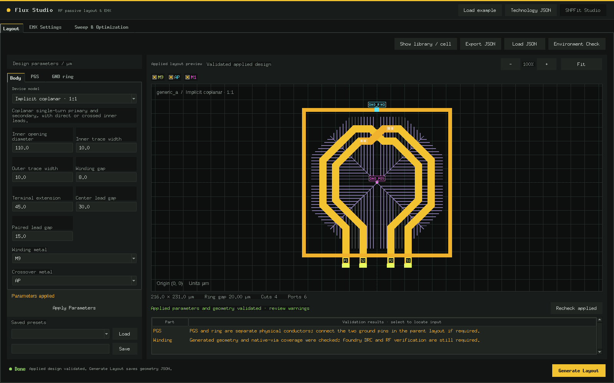

*内置差分电感（中心抽头、图形化接地屏蔽、地环），使用虚构示例技术。*

## 功能

- 开箱即用：预览及生成对称差分电感（可选中心抽头），可选图形化接地屏蔽（PGS）和地环。
- 以[结构包](docs/STRUCTURE_PACKS.md)加载更多结构：变压器、单端或抽头电感、巴伦以及自定义变体。结构包中的模型与内置电感共用参数面板、规则检查、原生版图生成、EMX、优化和 SNPFit 流程。
- 用 **Leg Pin 管理器**在引出线（leg）上放置自定义 pin，并为每个 EMX 目标或约束指定在哪两个 pin 之间计算。
- 在 2D 编辑器旁边用 **3D** 查看已应用的版图（可选，依赖 [Layout 3D Viewer](https://github.com/chloeyntu-byte/layout-3d-viewer)）。
- 使用用户 technology JSON 离线生成几何；原生模式读取用户 OA 设计库实际附着的技术。
- 配置 EMX、扫描类型化参数、多目标优化，查看候选表、热图、曲面及保留的 SNP 结果。
- 从选中结果打开内置 **SNPFit Studio**，也可单独启动，用明确的 RLC(K) 电路拟合 Touchstone 数据，导出数值结果与 SPICE 模型。

## 内置结构与结构包

开源版只内置**一种**结构：对称**差分电感**（可选中心抽头）。Flux 用过的其他电感/变压器结构，即隐式共面变压器（直连与交叉引线）、单端八边形电感、共面变压器、叠层变压器，每一种都是**独立的结构包**，不随本仓库提供。如需使用，请通过 [GitHub Issues](https://github.com/chloeyntu-byte/flux-studio/issues) 联系维护者。也可以自己编写结构包，见下文[结构包](#结构包)。

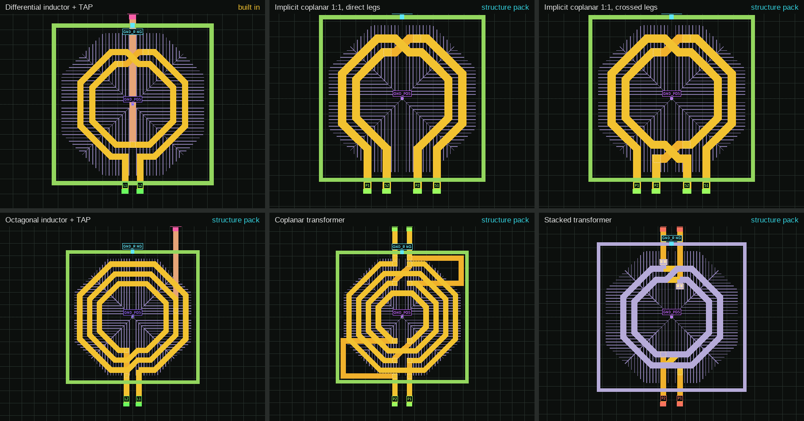

*左上为内置差分电感。其余均为**结构包**（不随仓库提供）：隐式共面 1:1 直连引线与交叉引线、带抽头八边形电感、共面变压器、叠层变压器。*

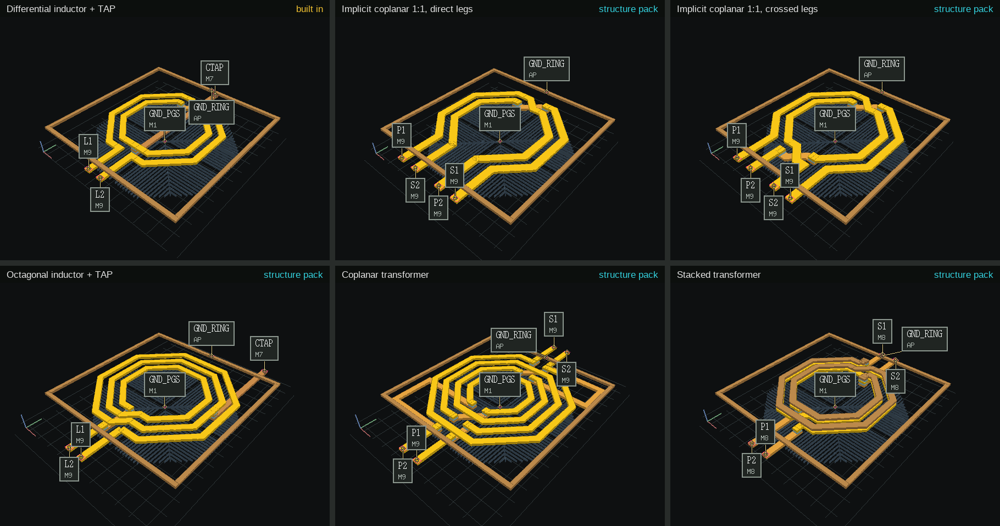

*同样六种版图的 3D Studio 视图。除左上角外均为**结构包**（不随仓库提供）。*

## 功能导览

### 版图预览与屏蔽

每次修改参数都由最终写版图的同一几何核心校验。**Apply Parameters** 重绘预览、列出规则警告，并保持视图与保存的设计一致。

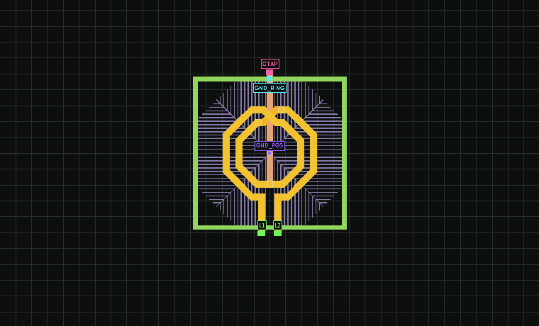

*改变内径、圈数和线宽，绕组、交叉、中心抽头、PGS 和地环每次都重新生成（内置差分电感）。*

图形化接地屏蔽（PGS）和地环是相互独立的可选部件，各自有金属层、尺寸和连接设置：

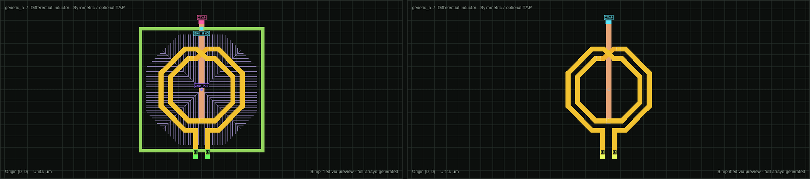

### 可选 3D 预览

预览工具栏上的 2D/3D 选择框在 2D 编辑器、**3D Studio**（实体金属）和 **3D Metal**（按金属层着色，可见 PGS 指条）之间切换。每次应用的预览（包括 Leg Pin 编辑）都会同步到 3D 视图。

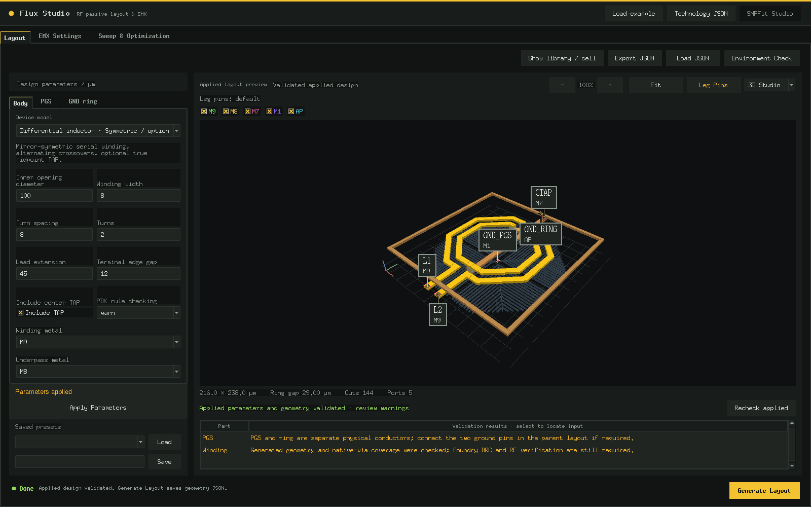

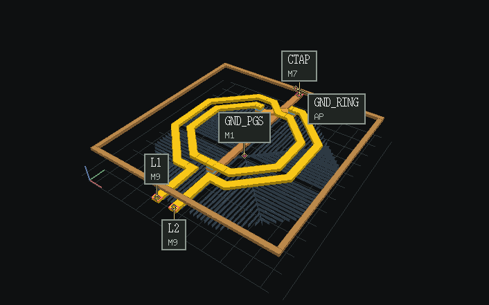

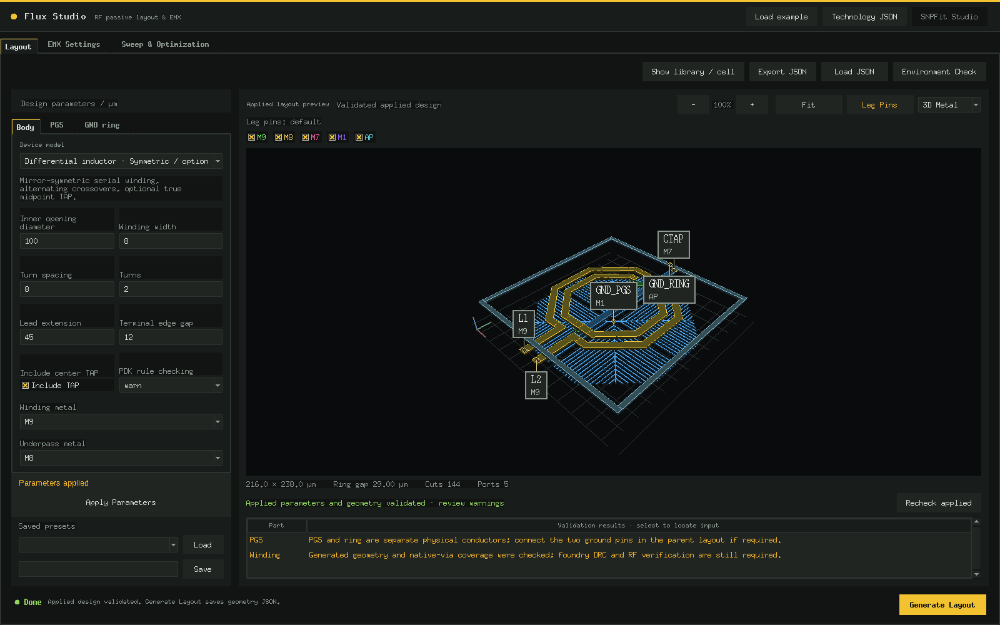


*叠层变压器的 3D Metal 视图。该结构是**结构包**，不包含在本仓库中。*

**3D 依赖 Layout 3D Viewer。** 3D 预览使用 [Layout 3D Viewer](https://github.com/chloeyntu-byte/layout-3d-viewer) 的嵌入接口：Flux 导入其 `native/embed.py` 模块，接口约定见该仓库的 [docs/EMBEDDING.md](https://github.com/chloeyntu-byte/layout-3d-viewer/blob/main/docs/EMBEDDING.md)。请使用 Layout 3D Viewer 最新版本。

```sh
git clone https://github.com/chloeyntu-byte/layout-3d-viewer.git /path/to/layout-3d-viewer
# 运行 Flux 的 Python 需要 PyOpenGL 3.1.7 和 pyopengltk 0.0.4；
# 装进单独目录，不改动该解释器本身
python3 -m pip install --target /path/to/flux-gl PyOpenGL==3.1.7 pyopengltk==0.0.4

export FLUX_VL3D_ROOT=/path/to/layout-3d-viewer     # Layout 3D Viewer 检出目录
export FLUX_VL3D_PYTHONPATH=/path/to/flux-gl        # 可选：上面的目录
python3 -B app.py --example
```

- 不设置 `FLUX_VL3D_ROOT` 时 Flux 只有 2D 预览，行为与之前完全相同，也不显示 3D 选择框。
- 使用 conda 或 miniforge 的 Python 时，请使用 Layout 3D Viewer 最新版本：Flux 在 Tk 启动前调用其 `prepare_runtime()`，先加载系统 GL 库，使 Tk 与 OpenGL 共用同一套 X11 库。
- `./launch.sh` 会传递这两个变量，也可以写进 `flux_config.sh`（参考 `examples/flux_config.sh`）。
- 若 3D 引擎无法加载，或首次打开视图时 OpenGL 初始化失败，Flux 会在状态栏说明原因并保持 2D。

### Leg Pin 管理器

预览工具栏上的 **Leg Pins** 把 Layout 页切换成引出线（leg）pin 编辑器。除 leg 外的几何全部变暗，pin 用醒目的单一颜色绘制；左侧面板列出每条 leg 及其 pin、距自由端的距离和长度。

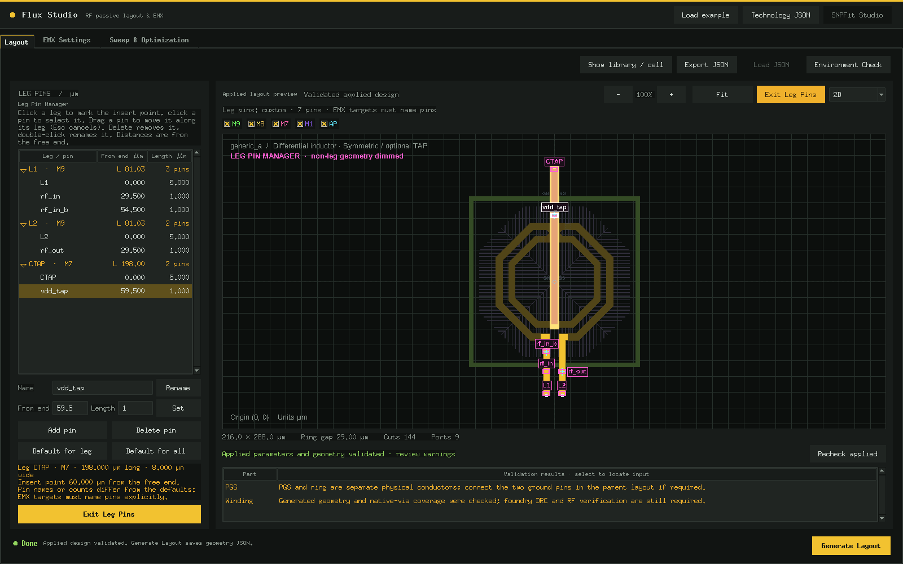

- 点击 leg 标记插入点，再点 **Add pin**（长 1 µm，宽度与 leg 相同）。每条 leg 可放多个 pin，也可以不放。
- 拖动 pin 沿所在 leg 移动（Esc 取消拖动）；双击或 **Rename** 改名；**Delete** 删除；**Default for leg / Default for all** 恢复默认 pin。
- 位置按 leg 长度的比例保存，扫参改变引线长度时，每个 pin 保持相对位置。
- 同名 pin 在 EMX 中构成一个短接端口（会先确认）。会把两个绕组连在一起、混用信号与 TAP，或复用地 pin 名的名称会被拒绝。
- pin 布局随设计 JSON、预设和 EMX campaign 一起保存；与默认相同的布局不会写入。

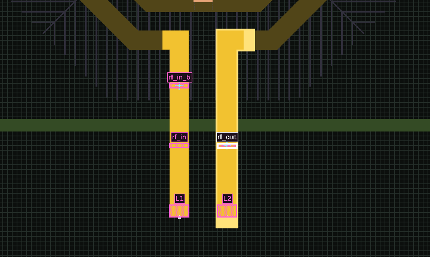

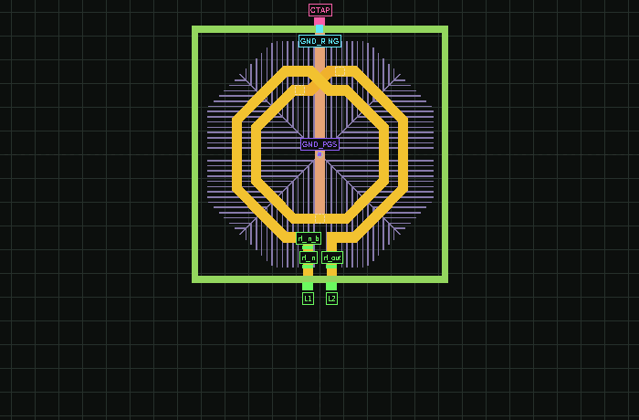

*左：沿 leg 拖动 pin。右：引线变长变短时，每个 pin 保持其在 leg 上的比例位置。*

启用 3D 预览后，Leg Pins 模式会把 2D 编辑器和 3D 视图并排显示；选中的 pin 在 3D 中高亮，在 3D 中点击 pin 会在编辑器中选中它（同名 pin 连续点击依次切换）。

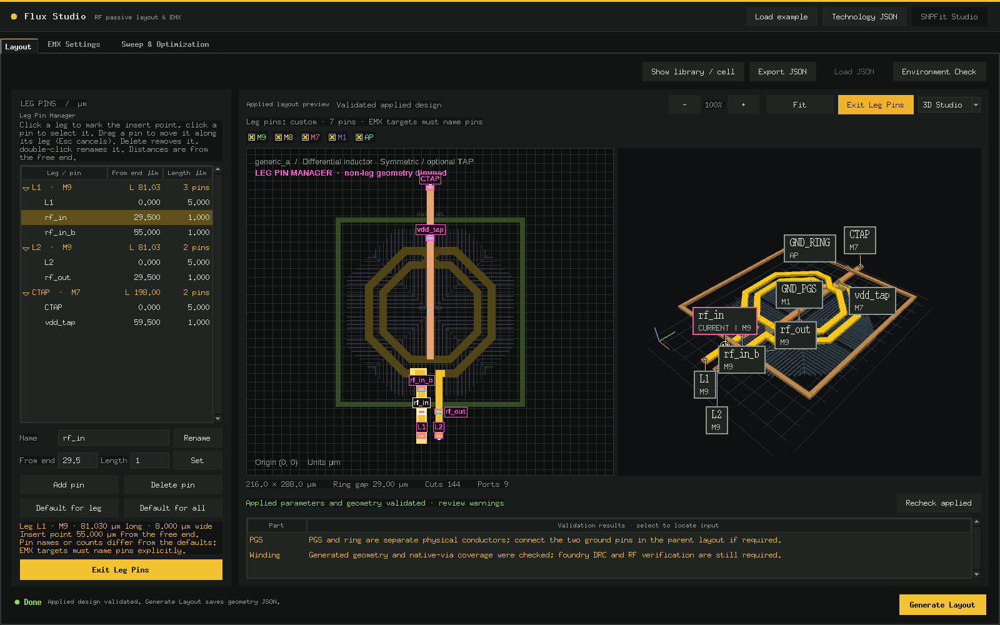

### 指定 pin 的 EMX 指标

目标和约束可以指定指标在哪些 pin 之间计算。目标编辑器中，L、Q、Lp、Ls、Qp、Qs 选一对差分 pin（+、−；其他信号 pin 开路），k 选两对。目标写作 `L[rf_in,rf_out]`，高级文本形式同样适用（`L[rf_in,rf_out], 2e9, maximize`）。

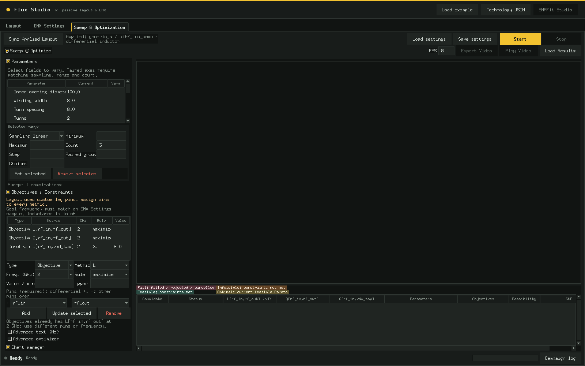

- 同一指标在不同 pin 上是不同的目标；结果表、图表和优化视频为每个指定 pin 的指标单独加一列。
- 未使用自定义 pin 时，pin 留空即使用内置的绕组端口对。版图一旦使用自定义 leg pin，每个指标都必须指定 pin；同步版图中已不存在的 pin 所在行显示为红色。

### 扫参与热图

扫参会用 EMX 求解所选参数取值的每一种组合。热图把两个扫描参数放在横纵轴上，每个格子的颜色表示某个频点下的一个指标（下图是 1 GHz 的 Qp），趋势和可用区域一眼就能看出来。点击格子会在结果表中选中对应的候选。

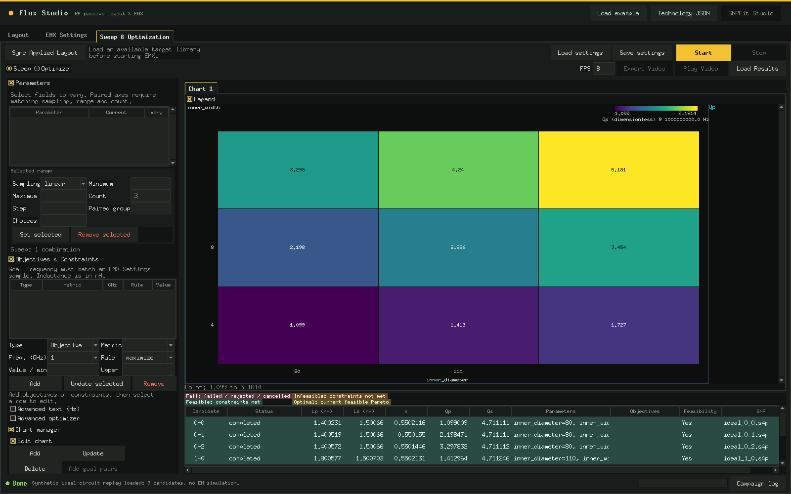

*九个理想耦合电感 SNP 的合成回放（见快速开始），不是 EM 预测。*

### 多目标优化与 Pareto 前沿

优化模式用 NSGA-II 在同一组参数上同时处理多个目标和约束，例如 Qp 越高越好、Lp 尽量接近目标值、耦合 k 越强越好。这种情况下很少有唯一的最优解。如果没有其他可行设计在所有目标上都不差、且至少一项更好，这个设计就在 **Pareto 前沿**上；前沿之外的设计至少在一个目标上更差，又没有在别处补回来。两个目标时前沿是一条曲线，三个目标时是一张可以旋转查看的曲面，沿着前沿移动，就能看到改善一个目标要在另一个目标上付出多少。

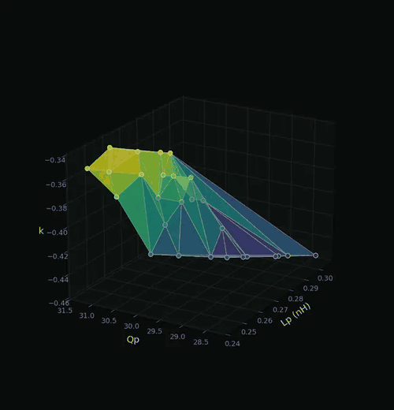

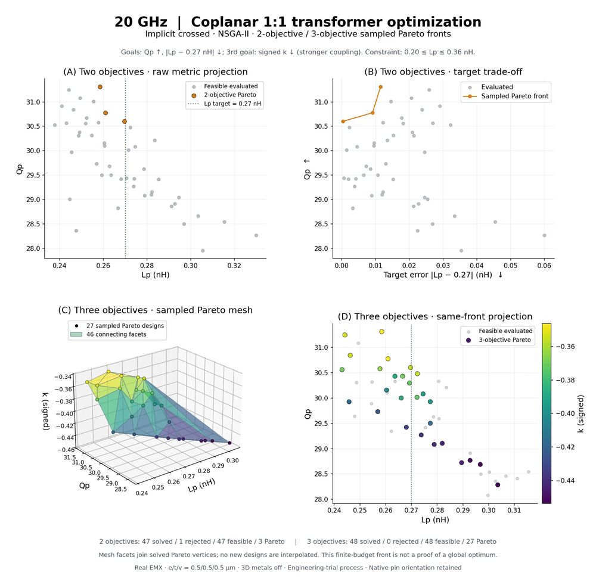

*真实的 EMX 优化：20 GHz 共面 1:1 变压器（隐式共面、交叉引线，属于**结构包**，不随仓库提供），同一结构分别做了两目标和三目标优化，曲面是三目标前沿。每个点都是一个实际求解的候选；曲面只连接已求解的 Pareto 设计，不做插值；有限预算得到的前沿不能证明是全局最优。*

### SNPFit：从 S 参数到等效电路

选中一个结果交给内置的 **SNPFit Studio**。它用明确的 RLC(K) 电路拟合 Touchstone 数据，逐点对比拟合模型与 EMX 样本（每个绕组的 L、Q 以及 k），并可以为电路生成原生原理图、符号和版图示意。SNPFit 也可以单独处理任意 Touchstone 文件（见快速开始）。

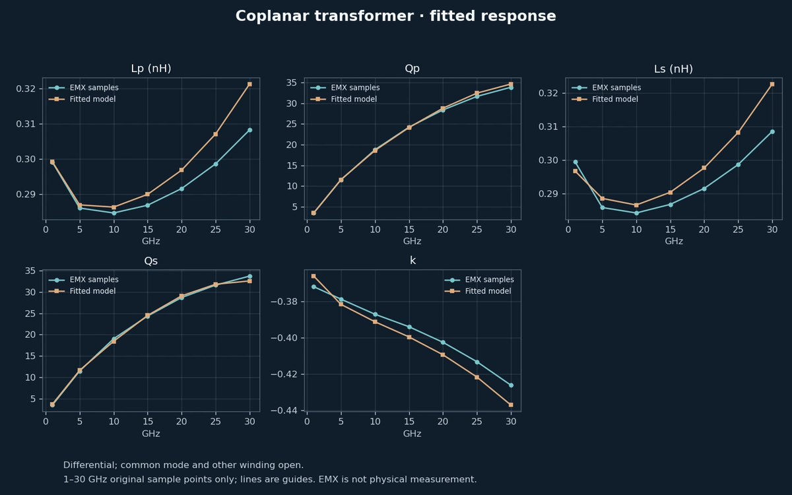

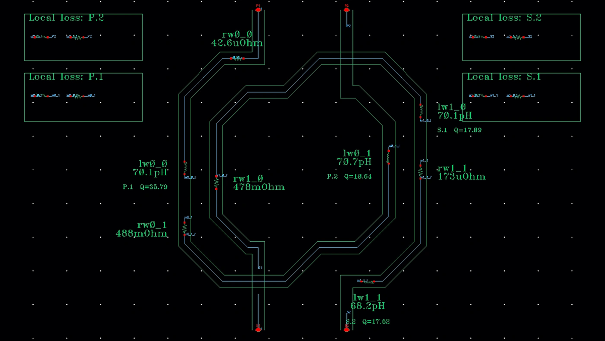

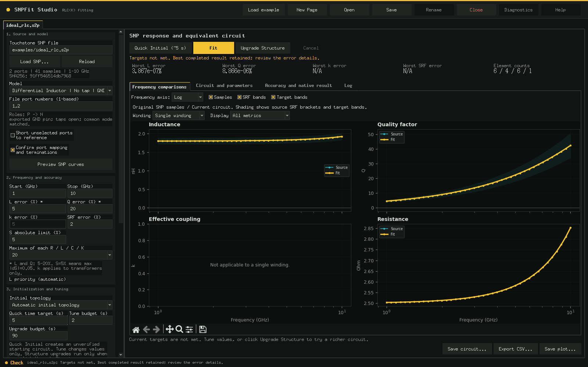

*前两张图来自一个独立生成、提取并拟合的共面变压器（属于**结构包**，不随仓库提供）；EMX 是仿真，不是实测。最后一张使用仓库自带的合成 RLC 示例。*

## 环境要求

使用已有的 **Python 3.11+**、Tk、NumPy 和 Matplotlib。共享主题模块本身兼容 Python 3.6+ 与 Tk 8.5/8.6。本次在 Linux、Python 3.11、NumPy 2.4、Matplotlib 3.10 上验证；启动器不安装环境或系统组件。Flux 几何 CLI 只依赖标准库。

对应原生操作还需用户自己的 Cadence Virtuoso/Ocean、EMX、流片格式导出工具、Spectre、有效许可环境和技术数据，仓库均不附带。离线预览、合成示例与 SNPFit 数值计算无需 EDA 软件。本次未验证真实原生执行。

## 快速开始

在仓库根目录使用已有解释器：

```sh
python3 -B app.py --example
```

显示虚构技术版图，不启动原生工具。修改参数后点击 **Apply Parameters**，再点击 **Generate Layout** 保存几何 JSON。加载真实设计库后，同一按钮创建并读回验证新的 OA cell。不带 `--example` 启动时为空工作区，可点 **Load example**。

也可使用保留的环境感知启动器：

```sh
TFGEN_PYTHON=python3 ./launch.sh --example
```

启动器探测已有 Python/Tk，并只隔离 GUI 子进程环境。发现多个解释器时，用 `TFGEN_PYTHON` 指定现成的兼容解释器。可将 `examples/flux_config.sh` 复制为已忽略的本地 `flux_config.sh`，只设置需要覆盖的项；继承环境优先。

### 独立启动 SNPFit Studio

```sh
python3 -B -m snpfit gui --runtime ./local-runtime
```

点击 **Load example**，确认从 1 开始的端口映射，执行 **Quick Initial**，再点击 **Fit**。Quick Initial 生成未经资格验证的起始电路；Fit 只调元件值。**Upgrade Structure** 是单独、明确触发的操作。完整资格判断还需要足够频率覆盖及可分辨的自谐振；低频示例不代表宽带合格。

集成/原生使用也提供隔离环境的引导入口：

```sh
SNPFIT_PYTHON=python3 ./snpfit_launcher/launch gui --runtime ./local-runtime
```

`examples/ideal_rlc.s2p` 和 `examples/ideal_coupled.s4p` 由理想集总电路公式生成，不是实测或工艺仿真数据。重新生成：

```sh
python3 -B examples/generate_synthetic.py
```

查看合成 campaign（理想耦合电感回放，其设计标签指向一个未内置的变压器模型）：打开 **Sweep & Optimization**，点击 **Load Results**，选择 `examples/campaign`。添加图表，设置 X=`inner_diameter`、Y=`Qp`、Grid Y=`inner_width`、Y Hz=`1000000000.0`。数值由保留的理想电路 SNP 重建；几何标签仅作演示，不代表 EM 预测，此回放禁用原生候选操作。

## 结构包

开源版只内置一种结构：**差分电感**。其他结构都以结构包接入：一个 Python 文件（或包目录），定义 `register(flux)`，在其中调用 `flux.register_model(definition, builder)`。

```sh
# 从文件夹加载结构包（也可直接列出结构包文件），然后启动 Flux
FLUX_PACKS=/path/to/packs python3 -B app.py --example

# 或长期安装：packs/ 中除 README 外的内容均被 git 忽略
cp my_transformer_pack.py packs/

# 查看已加载的结构包、新增的模型和加载错误
python3 -B flux_cli.py packs
```

结构包模型自动获得：

- **界面**：模型出现在 Layout 页；参数面板、金属层选择和可选的引线变体按钮都按定义自动生成。
- **共享屏蔽**：PGS、地环和接地走线参数自动加到每个结构包模型上。
- **检查**：通过共享几何引擎做网格对齐、原生过孔阵列、线宽/间距规则、短路、断线和规则缺失警告。
- **后续流程**：原生 OA 版图生成、EMX 扫参（电感 L/Q，变压器 Lp/Ls/k/Qp/Qs）、NSGA-II 优化、结果图表和 SNPFit 拟合。
- **隔离**：出错的结构包会被报告并跳过，内置模型照常可用；`FLUX_PACKS_DISABLE=1` 只用内置模型。

可运行示例在 [`examples/packs/`](examples/packs/example_tapped_inductor.py)（`FLUX_PACKS=examples/packs python3 -B app.py --example`）。完整约定（定义字段、builder 签名、EMX 端口约定和辅助 API）见 [docs/STRUCTURE_PACKS.md](docs/STRUCTURE_PACKS.md#中文说明)。

## 用户技术与 Cadence

`examples/generic_technology.json` 完全**虚构**。M1..M9/AP 名称、任意层号、叠层顺序、过孔尺寸及规则不代表任何制造工艺，不可用于制造或真实流片映射。格式见[技术配置说明](docs/TECHNOLOGY.md)。

通过 **Technology JSON** 或 `app.py --technology your-technology.json` 加载用户 JSON。此入口仅支持离线预览/JSON 导出。原生输出仍使用精确关联的 OA 技术、真实层/过孔定义及用户现有库映射；通用示例不能授权原生写入。

原生工作先按 `examples/flux_config.sh` 配置工作区、库映射及已有工具，再通过 **Show library / cell** 的刷新/加载操作连接。调用版图的上下文可用 `./launch.sh --context context.json` 传入。EMX Settings 支持用户自行指定匹配的 process、layer map、工具、频点和输出目录；仓库不提供工艺叠层或许可配置。

SNPFit 原生设置接收工作区、库/cell、现有库路径、Virtuoso、Ocean、Spectre 和可选环境脚本。独立旧 API 可使用 `SNPFIT_ENV_SCRIPT` 或 PATH 中的工具。Flux 通过集成 API 传递选中结果记录的身份与原生环境。执行原生原理图/符号操作前应核对目标；集成覆盖请求会先备份已有视图。

## 面向 agent 的 CLI

```sh
python3 -B flux_cli.py models
python3 -B flux_cli.py packs
python3 -B flux_cli.py preview --technology examples/generic_technology.json \
  --design examples/layout_design.json --output layout.json
python3 -B -m snpfit models
python3 -B -m snpfit fit examples/ideal_rlc.s2p --model inductor_dm_gnd \
  --ports 1,2 --band-ghz 1 10 --error 20 --seconds 30 --runtime ./local-runtime
```

旧 `fit` 命令检查数值 L/Q 目标并导出结果，不执行原生验证。GUI Studio 快照使用分阶段 API（`python3 -m snpfit studio-action --help`）。集成 API 为 `python3 -m snpfit integration --request request.json`，可以写原生视图，必须由用户提供目标及 EDA 环境。运行请求可能含环境快照，应私下保存。

## 验证

```sh
DISPLAY=:88 python3 -B -m unittest discover -s tests
DISPLAY=:88 SNPFIT_GUI_TESTS=1 python3 -B -m unittest discover -s tests_snpfit
```

复现时使用自己的专用 X 显示。3D 测试使用替身引擎，不需要 OpenGL。仓库内技术、绕组参考和 SNP 夹具均为合成数据。保留测试覆盖几何、进程归属、环境隔离、集成合同、数值拟合与 GUI 状态；原生工具使用 mock。详见[发布说明](RELEASE_NOTES.md)与[截图](docs/screenshots/README.md)。当前数量：Flux 506 项测试，SNPFit 164 项（3 项跳过）。

## 限制

- 几何检查不等于 DRC/LVS 签核，必须使用真实技术 deck 和制造规则。
- 缺失规则及未验证的金属顺序保持明确警告，不补造缺失规则。
- Touchstone 只支持正实数参考阻抗，须明确映射端口；拒绝混合模式及压缩矩阵。
- 数值资格针对原始采样点及选定测量夹具；稀疏数据不能证明未分辨的谐振或连续宽带精度。
- SNPFit 绕组图是原理示意，S 数据本身不能识别物理金属层。
- 原生工具、许可、技术关联及其他机器的 ABI 需用户自行验证。本次只验证示例和 mock。

## RF-FIELDWORK

产品介绍页：https://rf-fieldwork.pages.dev/flux/?lang=zh（含配音演示片的工具在页面上可直接观看）

其他开源工具：

- [Cap Array Lab](https://github.com/chloeyntu-byte/cap-array-lab)：电容阵列 C/Q、寄生路径、谐振与 Z11
- [Layout 3D Viewer](https://github.com/chloeyntu-byte/layout-3d-viewer)：三维阅读版图、定位 pin、追踪连接
- [VCO ISF Explorer](https://github.com/chloeyntu-byte/vco-isf-explorer)：ISF、闪烁噪声上变频与相噪贡献
- [Crescendo](https://github.com/chloeyntu-byte/crescendo)：在 Cadence Maestro 里自动优化器件尺寸
- [VCO Design Studio](https://github.com/chloeyntu-byte/vco-design-studio)：五类文献 LC VCO 拓扑、分层原理图与原生导出

## 许可

MIT，见 [LICENSE](LICENSE)。内置栅格字体保留其[字体许可](video_font_LICENSE.txt)。Viridis 为 Nathaniel Smith 与 Stefan van der Walt 发布的公共领域色图。
